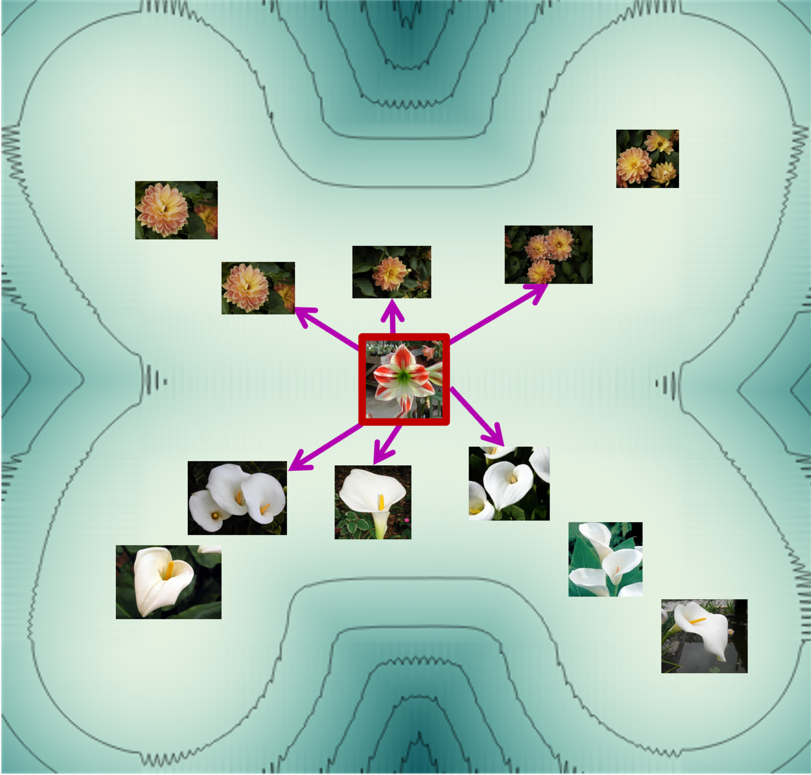
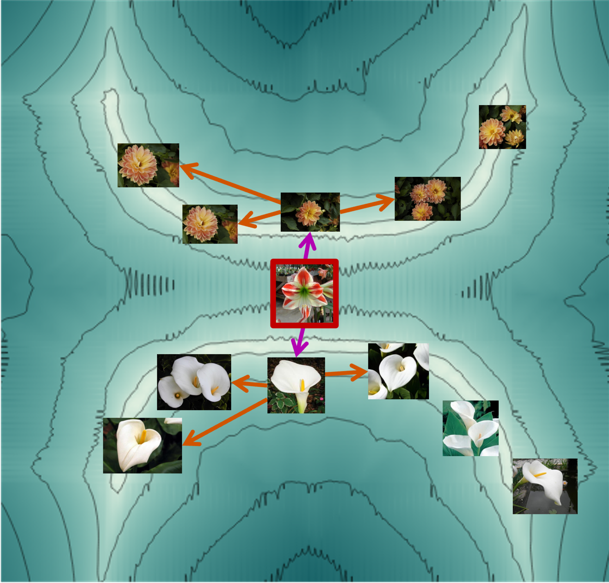

# knnn
K-Nearest Neighbors of Neighbors - for Anomaly Detection
```bash
pip install knnn
```
<div style="display: flex; justify-content: center; align-items: center; gap: 20px;">

  <div style="text-align: center;">
    
    <p>k-NN</p>
  </div>

  <div style="text-align: center;">
    
    <p>k-NNN</p>
  </div>

</div>

# Description
This package provides a simple implementation of the K-Nearest Neighbors of Neighbors algorithm. The algorithm is a simple extension of the K-Nearest Neighbors algorithm, which is used for anomaly detection. The algorithm is based on the idea that the neighbors of the neighbors of a point gives more information than its neighbors. The algorithm can be used to improve the accuracy of the KNN algorithm.


# Usage
``` python
from knnn import KNNN
import numpy as np

# Random data
x_normal = np.random.rand(100, 5)
x_test = np.random.rand(20, 5) + 1

# Create a KNNN object
knnn = KNNN(number_of_neighbors=3, number_of_neighbors_of_neighbors=25)
# Fit the model
knnn.fit(x_normal)
# Calculate anomaly scores (larger means more anomalous)
y_pred = knnn.predict(x_test)

```


# Installation
The simplest way to install the package is to run:
```bash
pip install knnn
```
If you want to install the latest version from the main branch:

(-e option will allow you to change the code without reinstalling the package)
```bash
git clone https://github.com/Onr/knnn.git
cd knnn
python3 -m pip install -e ".[dev]"
```
If you want to build the package from source, run:
```bash
python3 -m build
```
and to install the built package, run:
```bash
python3 -m pip install --force-reinstall dist/knnn-0.1.0-py3-none-any.whl
```
To run the tests, run:
```bash
python3 -m pytest -m "not benchmark and not external"
```

# Scoring and compatibility

Version 0.1.0 keeps L2 Mahalanobis scoring as the default (`p=2`), expressed
as RMS standardized eigenvector projections within each block. Numerically
singular local covariances use Euclidean distances, following the original
estimator's identity-matrix fallback. Select `p=1` for the paper's absolute
projections divided by the square root of each local covariance eigenvalue.
Both modes weight block scores by their feature counts and average over
neighbors. Existing thresholds should be recalibrated because grouping,
partial blocks and score normalization have changed.

L1 scoring is an explicit option: the audit's double-root bug is absent from
v0.0.9, and strict inverse-variance weighting of singular sparse neighborhoods
reduced accuracy in the Digits comparison. Exact scoring is not a guarantee
of higher accuracy on every dataset.

Features are greedily grouped by absolute correlation into blocks of at most
`set_size` dimensions. All features are retained, including a smaller final
block. Use `set_size=-1` for a single block. Constant features are supported;
a query that changes a feature that was constant during training receives the
largest finite float score, as in the previous release.

`batch_size=256` bounds temporary covariance and projection arrays during fit
and inference. Stored eigenvectors still require O(N × D × set_size) memory.
Neighbor counts are capped to the available training samples without changing
constructor parameters. At least two samples are needed per fitted model.

`KNNN.predict(X)` and `KNNN(X)` continue to return continuous anomaly scores.
`KNNN.score_samples(X)` returns their negatives, so higher means more normal.
KNNN supports sklearn cloning, pipelines and parameter searches; pass an
explicit scoring function to `GridSearchCV`. It does not implement sklearn's
thresholded `OutlierMixin` contract.

For classification, use the sklearn-compatible estimator:

```python
from knnn import KNNNClassifier
from sklearn.pipeline import make_pipeline
from sklearn.preprocessing import StandardScaler

classifier = make_pipeline(
    StandardScaler(), KNNNClassifier(distance_function="euclidean")
)
classifier.fit(X_train, y_train)
labels = classifier.predict(X_test)
```

Class columns follow sorted `classes_`. `predict_proba` returns votes for the
minimum-score classes, splitting ties equally; these are not calibrated
probabilities. The original `KNNN_class(number_of_classes=...)` callable and its
tuple results are retained.

The estimator now uses scikit-learn for nearest neighbors. Runtime dependencies
are NumPy and scikit-learn (plus their transitive dependencies). The legacy
`get_features_knn_faiss` helper requires `pip install "knnn[faiss]"`.
Diagnostic `knn_distance` values retain cosine distances or squared Euclidean
distances; the legacy dictionary key `knn_indeises` is retained.

# Development and release

```bash
python3 -m pip install -e ".[dev]"
python3 -m pytest -m "not benchmark and not external"
python3 -m build
python3 -m twine check dist/knnn-0.1.0*
```

The comparative benchmarks assert that k-NNN outperforms k-NN on particular
samples; they are marked `benchmark`. Run them with
`python3 -m pytest -m "benchmark and not external"`. These comparisons can fail
when k-NNN ties or underperforms k-NN; they are not correctness guarantees.
Tests marked `external` require Hugging Face downloads or local ADB datasets.
Set `KNNN_ADB_DATASET_PATH` to the directory containing the ADB dataset folders;
missing local datasets are reported as skipped.

Release files are `dist/knnn-0.1.0-py3-none-any.whl` and
`dist/knnn-0.1.0.tar.gz`. Install the wheel directly with:

```bash
python3 -m pip install dist/knnn-0.1.0-py3-none-any.whl
```

# Cite
```bib
@inproceedings{nizan2024k,
  title={k-NNN: Nearest Neighbors of Neighbors for Anomaly Detection},
  author={Nizan, Ori and Tal, Ayellet},
  booktitle={Proceedings of the IEEE/CVF Winter Conference on Applications of Computer Vision (WACV) Workshops},
  pages={1005--1014},
  year={2024}
}
```
